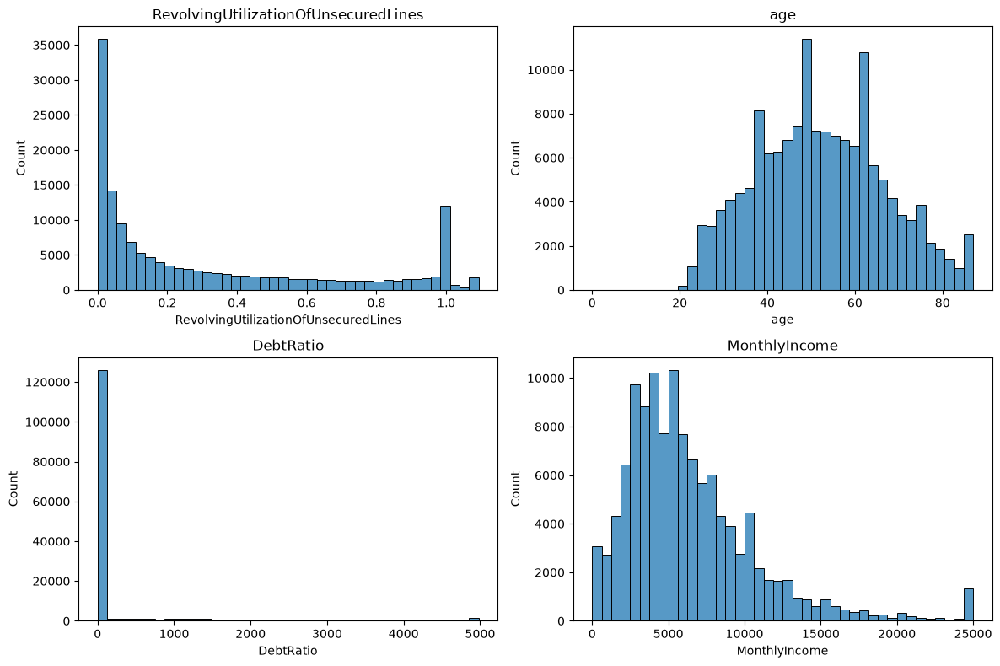

# Credit Risk Assessment

Predicts whether a borrower will become seriously delinquent within 2 years, explains each prediction with SHAP, and serves risk scores through a Streamlit app.

| | |
|---|---|
| **Intern ID** | CITS9513 |
| **Full Name** | Arpan Pal |
| **No. of Weeks** | 8 Weeks |
| **Project Name** | Credit Risk Assessment |

## Project Scope

Build an end-to-end credit risk model on the "Give Me Some Credit" dataset: clean and engineer features, handle class imbalance, compare logistic regression and LightGBM, choose a cost-based decision threshold, explain predictions with SHAP, and ship a Streamlit app that scores an applicant.

## Results at a Glance

Evaluated once on a held-out, stratified test set of 30,000 borrowers (2,005 defaulters).

| Model | ROC-AUC | PR-AUC | Recall | Precision | Cutoff | Cost (millions) |
|---|---|---|---|---|---|---|
| Logistic regression (baseline) | 0.831 | 0.368 | 0.563 | 0.335 | 0.6 | 7.50 |
| **LightGBM (chosen)** | **0.870** | **0.401** | **0.599** | **0.344** | 0.7 | **7.11** |

- Approving everyone would cost about 12.0M under the assumed costs, so the chosen model cuts the cost by about **41%**.
- Test scores match the cross-validation scores (LightGBM ROC-AUC 0.865 and PR-AUC 0.401 in cross-validation), which suggests the model is not overfitting.
- LightGBM's confusion matrix on the test set: 25,706 true negatives, 2,289 false positives, 804 false negatives and 1,201 true positives.


## Business Framing

A bank loses money in two ways:

- **False negative:** approving a borrower who then defaults. Cost: the lost part of the loan.
- **False positive:** rejecting a borrower who would have repaid. Cost: the lost interest profit.

These errors are not equally expensive, so accuracy alone is misleading. About 7% of borrowers default, which means a model that approves everyone scores about 93% accuracy while catching no defaulters.

I used these **illustrative assumptions** (adjustable, not taken from the dataset):

| Assumption | Value |
|---|---|
| Typical loan | 10,000 |
| Profit if a good borrower repays | 1,000 |
| Share of the loan lost on default | 60% |
| **Cost of a false negative** | **6,000** |
| **Cost of a false positive** | **1,000** |

Total cost = `FN x 6,000 + FP x 1,000`.

## Dataset

- Source: Kaggle, "Give Me Some Credit" (`cs-training.csv` only; the test file has no labels, so I made my own split).
- 150,000 borrowers, 10 raw features plus the target `SeriousDlqin2yrs`.
- About 6.7% of borrowers defaulted (heavily imbalanced).
- `MonthlyIncome` is missing for about 20% of rows and `NumberOfDependents` for about 2.6%.

The dataset is not included in this repository. See "How to Run" for where to download it.

## Approach

Each step has a matching notebook in `notebooks/`.

| # | Step | What I did and why |
|---|---|---|
| 01 | Business framing | Defined the cost of each error type so the model is judged by business impact. |
| 02-03 | Load and EDA | Inspected shape, types, missing values and distributions. `MonthlyIncome`, `DebtRatio` and utilization are heavily right-skewed, so I used medians and percentile-clipped plots for display only. |
| 04 | Data quality | Found placeholder codes (96/98) in the three past-due columns. Those rows default at a much higher rate than average, so I kept them, turned the codes into missing values and added an indicator flag. One impossible age (0) was dropped. A missing-income flag was added. |
| 05 | Feature engineering | Added three interpretable features: total late payments, income per household member and an over-limit flag. They use only same-row values and never the target. |
| 06 | Split | Stratified 80/20 train/test split (`random_state=42`), preserving the default rate in both parts. All learned preprocessing is fitted on training data only. |
| 07 | Metrics | Precision, recall, ROC-AUC, PR-AUC (baseline about 0.067) and the confusion matrix. Accuracy is never used alone. |
| 08 | Baseline | Logistic regression with median imputation, scaling and balanced class weights in a scikit-learn Pipeline, evaluated with 5-fold stratified cross-validation on the training set. |
| 09 | Imbalance | Compared class weights with SMOTE (inside an imblearn Pipeline so it only touches training folds). Both gave ROC-AUC of about 0.82 and PR-AUC of about 0.37, so I kept class weights for simplicity and zero leakage risk. |
| 10 | Gradient boosting | LightGBM with balanced class weights, tuned by random search with stratified 5-fold cross-validation on PR-AUC (training data only). |
| 11 | Threshold | Chose the cutoff by minimizing total business cost on out-of-fold training predictions, not the default 0.5. |
| 12 | Final test | Scored the sealed test set once, with each model's own cutoff chosen from training data. |
| 13 | Explainability | SHAP global importance and a single-applicant explanation. |
| 14 | Calibration | Isotonic calibration so displayed probabilities match observed default rates. |
| 15 | Save the model | Saved the calibrated model, its feature list and the cutoff with joblib. |

Reproducibility: `random_state=42` everywhere, and reusable code lives in `src/` (`preprocess.py`, `train.py`, `evaluate.py`).

### Data leakage controls

- The split happens before any learned step (imputation, scaling, resampling, tuning).
- Imputers and scalers live inside Pipelines, so they are refitted on each training fold only.
- SMOTE (comparison only) lives inside an imblearn Pipeline.
- Cutoffs and tuning use cross-validation inside the training set. The test set was used once.

## Choosing the Decision Threshold

The best cutoff is the lowest point of the cost curve, not the point that catches the most defaulters. Flagging more people catches more defaulters but also rejects more good borrowers.


Class weights inflate the raw scores, so the best raw cutoff for LightGBM is 0.7. After calibration, the matching cost-based cutoff is `1,000 / (1,000 + 6,000)`, about **14%**, which is what the app uses.

## Imbalance Handling: Class Weights vs SMOTE


## Explainability (SHAP)

Past-due behaviour and credit utilization push predicted risk up the most, while age pushes it down. This matches the patterns found in EDA.

**Global importance and direction**


**One applicant explained.** For this high-risk example, every bar pushes risk up. The biggest drivers are 8 total late payments, a utilization of 1.256 (over the limit), 3 times 90+ days late and 2 times 60-89 days late. The raw model score rises from the average of -1.013 to 3.817 (about 0.98 as a probability). A bank could therefore say *why* an applicant was flagged, not just that they were.


## Streamlit App

The app collects 10 applicant inputs, applies the same preprocessing functions used in training, and returns a calibrated default probability with a flag against the cost-based cutoff. The model and its feature list are loaded from one joblib file, so the columns always arrive in the training order.

| Not flagged (below cutoff) | Flagged (above cutoff) |
|---|---|
|  |  |

## Exploratory Data Analysis



## Repository Structure

```
credit-risk-project/
├── app.py                  # Streamlit app
├── notebooks/              # 01 to 15, in order
├── src/
│   ├── preprocess.py       # rule-based cleaning and feature engineering
│   ├── train.py            # model and pipeline builders
│   └── evaluate.py         # metrics report
├── reports/
│   ├── best_lgbm_params.json
│   ├── threshold.json
│   └── figures/            # charts and screenshots used in this README
├── data/                   # git-ignored (raw and processed data)
├── models/                 # saved model (credit_model.joblib)
├── requirements.txt
└── README.md
```

## How to Run

### Quick start: try the app

The trained model is included in `models/`, so you do not need the dataset to try the app.

1. Create a virtual environment and install the packages (Python 3.10+):
   ```
   python -m venv .venv
   .venv\Scripts\activate        # Windows (macOS/Linux: source .venv/bin/activate)
   pip install -r requirements.txt
   ```
2. Start the app from the project root:
   ```
   streamlit run app.py
   ```

### Full reproduction (optional)

To rebuild everything from the raw data:

1. Download `cs-training.csv` from Kaggle's "Give Me Some Credit" competition and place it in `data/raw/`.
2. Run the notebooks in order (01 to 15). Notebook 06 creates the train/test files, and notebook 15 recreates `models/credit_model.joblib`.

## Limitations

- **Costs are assumptions.** The 6:1 cost ratio is illustrative, not from a real bank. A different ratio changes the best cutoff.
- **One dataset, one split.** The data comes from a single public source with no dates, so I could not test whether the model holds up over time.
- **No fairness audit.** Age is a feature, and many regulators restrict using age in real lending decisions. This is a learning project, not a compliant scorecard.
- **Placeholder codes are inferred.** I treated 96/98 in the past-due columns as codes based on the data pattern, not on documentation.
- **Modest tuning gains.** Tuning improved PR-AUC only slightly, and the gap between the two models in cost is about 5%.
- **Not for real decisions.** The app is a demonstration.

## Possible Next Steps

- Test sensitivity to different cost ratios.
- Check stability over time with a time-based split, if dated data becomes available.
- Add a fairness and bias review, and a monitoring plan for score drift.

## Tech Stack

Python, pandas, NumPy, matplotlib, seaborn, scikit-learn, imbalanced-learn, LightGBM, SHAP, Streamlit, joblib. Developed in VS Code with Jupyter notebooks.

## Acknowledgements

Dataset: "Give Me Some Credit", Kaggle.